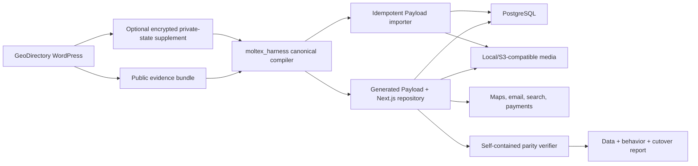
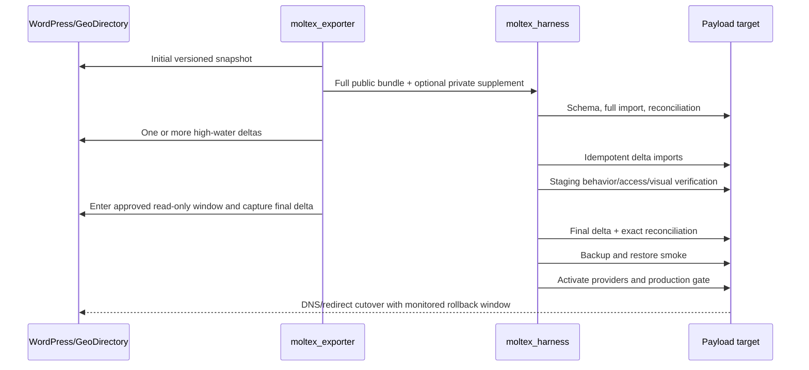

# GDirectory Replatforming Plan

Status: standalone product and implementation roadmap

## Document Contract

This document is the sole planning authority for the proposed GeoDirectory-to-Payload
product line. It keeps that future application-replatforming work separate from the
existing Moltex WordPress-to-Astro exporter and harness plans.

The existing `moltex_exporter` and `moltex_harness` implementations remain reusable
platform inputs where explicitly named, but their current planning documents do not own or
promise the work below. No third implementation project is created by this document;
repository structure is a later product decision.

The working product assumption is one migration platform with a separately positioned
directory product: an integrated Payload CMS and Next.js application backed by PostgreSQL,
rather than Payload serving the existing static Astro target.

## Product Boundary and Promise

- Existing product: `wordpress-content-astro/1`, governed by `moltex.md` and
  `moltex_harness.md`.
- Proposed separate directory product: `geodirectory-payload/1`, governed only by this
  document until the product and repository structure are deliberately changed.

> The directory product inventories a real GeoDirectory application, transfers its
> complete approved content and operational state into a generated, self-hostable Payload
> application, and proves every observed in-scope field, setting, route, workflow,
> permission, and public behavior is reproduced or has an explicit approved disposition.

This is feature-accounted parity for a certified source profile, not a promise that every
WordPress or GeoDirectory extension can be translated automatically. Unknown active
behavior blocks the parity claim.

## GeoDirectory-to-Payload Product Expansion

This section owns the product scope, exporter work, qualification rules, and end-to-end
acceptance for the planned directory profile. Detailed canonical models, Payload project
generation, data import, functional verification, and eval phases are owned by the
[implementation section below](#geodirectory-to-payload-implementation-plan).
The accepted H1-H6 Astro phases remain valid for the content-led profile and are not
retroactively renamed or presented as Payload support.

### Strategic outcome

Moltex will become a profile-driven migration compiler rather than a universal static-site
converter. The first application profile will target sites built with GeoDirectory core
and an explicitly certified set of official add-ons. It will generate a complete,
self-hostable Payload application whose owners control:

- Payload and frontend source code;
- PostgreSQL schema and reviewed migrations;
- all migrated public and approved private data;
- logo, favicon, media library, category imagery, theme tokens, navigation, and page shell;
- one generated Payload collection for each source GeoDirectory custom post type;
- typed custom fields, relationships, locations, search facets, sorts, tabs, and templates;
- roles, ownership, moderation, submissions, reviews, claims, jobs, and email templates
  covered by the selected certification profile;
- provider adapters and credentials for maps, geocoding, email, storage, search, analytics,
  spam protection, and payments; and
- the independent parity contracts, import receipts, cutover report, and rollback runbook.

The generated application has no runtime dependency on WordPress, GeoDirectory, Moltex,
Codex, or an OpenAI API. It may use operator-selected infrastructure services only when
their behavior and data ownership are explicit.

### What feature parity means

Feature parity is measured against the **observed source application**, not against every
feature that any historical GeoDirectory release or third-party plugin could theoretically
provide. Moltex maintains a versioned parity ledger with six dimensions:

| Dimension | Required evidence and proof |
|---|---|
| Data | Every in-scope source row or object has one target identity, relationship mapping, content hash, and import receipt; counts and sampled values reconcile. |
| Schema and settings | Every active CPT, taxonomy, field definition, validation rule, display rule, search/sort/tab rule, route rule, and safe operational setting maps to generated Payload configuration or an approved replacement. |
| Public behavior | Listing detail/archive/location/category routes, maps, filters, sorting, pagination, SEO, redirects, reviews, and responsive templates pass contract and browser flows where observed. |
| Authenticated workflow | Login/reset, listing submission and editing, ownership, moderation, claims, favorites/lists, review submission, and role boundaries pass actor-specific flows when included in the certified profile. |
| Presentation | Brand assets and representative route families meet approved desktop/mobile visual tolerances; content and interaction remain accessible. |
| Operations | Email, jobs, storage, maps/geocoding, search indexes, spam controls, payments, backups, observability, cutover, and rollback have configured adapters and test receipts. |

Parity has three valid outcomes per observed feature:

1. **Reproduced** — the Payload application implements the behavior and its automated
   checks pass.
2. **Replaced with approval** — the operator selects a semantically equivalent provider or
   workflow, and replacement-specific checks pass.
3. **Approved omission** — the operator accepts removal before import; the omission remains
   visible in the final report.

`needs_decision`, `unknown`, `not_exported`, `import_failed`, and `unverified` are never
passing final states. “All settings migrated” means all active settings are accounted for
semantically. WordPress-only implementation details such as cache transients, nonce values,
cron locks, or admin-screen coordinates are preserved as diagnostic evidence when useful
but are not copied into Payload as meaningless settings.

### Realistic parity boundary

Moltex can target 100% data and feature-accounting parity for certified profiles. It must
not promise automatic pixel-perfect or implementation-identical conversion for arbitrary
GeoDirectory ecosystems. The likely permanent human checkpoints are:

- privacy approval for users, owners, claims, pending reviews, and other non-public data;
- selection and credentialing of map/geocoding, email, object-storage, anti-spam, analytics,
  and payment providers;
- approval of new interaction design where WordPress shortcodes/widgets have no meaningful
  one-to-one target;
- payment/subscription reconciliation and sandbox-to-production activation;
- accessibility and responsive visual review; and
- cutover timing, final delta, DNS, and rollback authority.

Manual polish is acceptable after generation; missing or unverified behavior is not.
Moltex may report “migration complete” only after the final imported application, rather
than merely the generated code, passes the applicable parity gates.

### Target application architecture

The primary generated target is an integrated Payload and Next.js application. Astro
remains the content-only output profile and is not placed in front of Payload for the
directory-parity profile.



Architectural defaults:

- Payload's current accepted stable release is pinned through a tested compatibility
  profile; upgrades require a generated-project compatibility fixture.
- Next.js App Router hosts both Payload and the frontend because directory parity requires
  authenticated and transactional server behavior.
- PostgreSQL is the default database. Geo queries use Payload's supported point/query path
  when the pinned adapter proves the required semantics and scale; otherwise a reviewed
  PostGIS/Drizzle query adapter owns radius, bounding-box, and ranking behavior.
- Development uses a disposable local database and filesystem/S3-compatible storage.
  Production providers are selected explicitly and configured only through environment
  variables or secret stores.
- The generated repository contains database migrations, seed/import code, typed generated
  Payload models, an `.env.example`, containerized local services, backup/restore scripts,
  and a standalone verifier.
- Source identifiers are retained under immutable `legacy` metadata with unique indexes so
  imports are idempotent and incremental deltas cannot duplicate records.

The official Payload documentation supports the core building blocks: code-first
[configuration](https://payloadcms.com/docs/configuration/overview), granular
[access control](https://payloadcms.com/docs/access-control/overview), auth-enabled
[collections](https://payloadcms.com/docs/authentication/overview), indexed point fields and
geospatial queries through the [Point field](https://payloadcms.com/docs/fields/point), the
first-party [Search plugin](https://payloadcms.com/docs/plugins/search), database
[transactions](https://payloadcms.com/docs/database/transactions), and self-hosted
[storage adapters](https://payloadcms.com/docs/upload/storage-adapters). These primitives
make Payload suitable; they do not remove the need to implement and verify GeoDirectory
semantics.

### Generated directory ownership model

Each source GeoDirectory CPT becomes one generated Payload collection created through a
shared listing-collection factory. This preserves the owner's conceptual separation of
places, events, professionals, properties, or custom listing types while avoiding copied
behavior.

The generated project contains, when observed and in profile:

- staff and member authentication with distinct admin access;
- media, pages, posts, redirects, forms, and site-wide globals;
- one listing collection per GeoDirectory CPT;
- per-CPT category and tag/amenity collections plus declared CPT relationships;
- hierarchical countries, regions, cities, and neighborhoods;
- reviews and rating dimensions;
- listing ownership, submission state, moderation history, and audit metadata;
- claims and verified-listing state;
- favorites and user-defined lists;
- events and occurrences;
- packages, entitlements, orders, subscriptions, expiration, and renewal only in the
  commercial certification profile; and
- immutable source/import receipts unavailable to ordinary editors.

Custom fields use a hybrid ownership model:

- source-defined, queryable fields compile to typed Payload fields and database indexes;
- labels, help text, ordering, visibility, facet membership, sort behavior, tab placement,
  and presentation rules are editable through directory configuration documents/globals;
- unknown values remain in a quarantined `legacyExtra` object until an adapter is approved;
- storage-type changes generate reviewed code and database migrations rather than mutating
  production schema implicitly; and
- the generated schema manifest maps every WordPress field key to its Payload path, type,
  transformation, privacy class, index, and verification rule.

This gives operators complete source-code and data control without pretending that a
runtime CMS can safely add arbitrary indexed database columns with no migration.

### GeoDirectory feature certification levels

Certification is additive. A site qualifies only when every active GeoDirectory component
and relevant integration fits its selected level.

| Level | Certified scope | Completion evidence |
|---|---|---|
| GD0 — Inventory | Core/add-on/version detection, content and table reconciliation, settings inventory, privacy classification, scale estimate | Complete capability ledger; no migration claim |
| GD1 — Public directory | CPTs, typed fields, locations, taxonomies, listings, galleries, approved reviews, routes, archives, category/location pages, search/filter/sort/pagination, maps, branding, navigation, SEO, redirects | Data reconciliation plus anonymous browser and visual parity |
| GD2 — Managed directory | GD1 plus member accounts, ownership, frontend add/edit, drafts, moderation, review submission, favorites/lists, claims, verified state, email workflows, anti-spam | Actor/access matrix and authenticated workflow parity |
| GD3 — Commercial directory | GD2 plus packages, entitlements, paid/featured listings, expiration, renewal, invoices/orders, provider customer/subscription references, webhooks, and payment recovery | Sandbox transaction, webhook idempotency, entitlement, and financial reconciliation |
| GDX — Add-on adapter | Events, MultiRatings, Location Manager, Custom Post Types, List Manager, Franchise Manager, Saved Search Notifications, Social Importer, BuddyPress or other named integration | Separate adapter contract, fixture, negative mutations, and release matrix per add-on |

Location Manager and Custom Post Types are expected early adapters because they define the
shape of many production directories. Pricing Manager and Claim Listings are not inferred
from generic post meta: their own state machines and integrations require dedicated
adapters. GeoDirectory's official add-on catalog illustrates why this must be profile-based:
it spans location hierarchy, advanced search, linked CPTs, payments, claims, reviews,
events, user lists, franchises, imports, and social behavior
([official add-ons](https://wpgeodirectory.com/downloads/category/addons/)).

### Required source evidence expansion

The current `geodirectory.json` is sufficient only for a static subset. The new profile
requires a versioned `moltex-export/2` contract with sharded, streamable artifacts and a
complete producer/consumer declaration. The standard public bundle remains secret-free.

Required evidence families:

- exact WordPress, GeoDirectory core, official add-on, theme, and integration versions;
- activated feature fingerprint and compatibility classification;
- complete CPT registration arguments, permalink bases, archives, relationships, labels,
  capabilities, supports, and public/query behavior;
- complete GeoDirectory field definitions including type, options, validation, defaults,
  required state, admin/public visibility, package availability, search, sort, and tab rules;
- GeoDirectory's sanitized native settings export plus typed canonical settings evidence;
- complete listings, location hierarchy, taxonomies, term metadata, CPT relationships,
  galleries, approved reviews/ratings, and route/SEO data;
- map provider, units, defaults, marker/category icon relationships, clustering, geocoding,
  and location URL rules without credentials;
- templates, assigned pages, blocks/shortcodes/widgets, CSS/theme tokens, logos, icons,
  fonts, navigation, emails, and automatically captured route-family visuals;
- role/capability definitions and ownership counts, with identities only in the approved
  private supplement;
- submission, moderation, claim, review, event, favorite/list, package, entitlement,
  expiration, order/subscription reference, notification, and scheduled-job state for each
  installed certified adapter;
- integration endpoints and semantic configuration with secrets redacted and emitted as
  target `SecretRequirement` records; and
- export high-water marks, source changes observed during capture, shard counts, checksums,
  and final-delta lineage.

Exporter queries must use GeoDirectory APIs where those APIs provide the authoritative
public contract and use reviewed exact table adapters only where necessary. GeoDirectory's
own import/export surface includes listings, reviews, categories, settings, and locations,
which should be used as a reconciliation oracle rather than silently replaced by generic
WordPress post export
([GeoDirectory settings export](https://wpgeodirectory.com/documentation/article/explore-settings/settings-overview-for-import-export-settings/)).

### Private and transactional state

Authenticated parity cannot be delivered from the current public, privacy-filtered ZIP.
Moltex therefore uses two separate handoffs:

1. The standard public evidence bundle, safe for reviewed local development and sanitized
   fixtures.
2. An optional operator-authorized encrypted private-state supplement for production
   migration. It is encrypted to a locally generated migration recipient, never committed,
   extracted only into an ephemeral restricted directory, checksum-bound to the public
   bundle, and excluded from ordinary reports and prompts.

The private supplement may include member identity, listing ownership, claims, pending
moderation state, private lists, and provider reference IDs only when necessary and legally
approved. It never contains payment-card data, provider secrets, session tokens, raw
passwords, or reusable authentication cookies. WordPress password hashes are not treated as
portable credentials: imported accounts begin in a migration-pending state and complete a
verified password-reset or identity-provider activation flow before access.

Every private field has purpose, lawful-basis/approval, retention, target path, redaction,
and deletion metadata. Test fixtures use synthetic identities only.

### Exporter roadmap

#### Phase E4 — Define and emit `moltex-export/2` for directory applications

Objective: remove the current static and 5,000-item assumptions without changing the
accepted `moltex-export/1` fixture.

Build:

- publish the target-profile, feature-fingerprint, sharded artifact, high-water-mark, and
  secret-requirement schemas;
- add exact GeoDirectory core, Location Manager, Custom Post Types, Advanced Search, and
  MultiRatings detection/version adapters;
- emit complete field, CPT, taxonomy, location, relationship, settings, route, branding,
  review, map, and presentation evidence;
- replace per-CPT in-memory arrays with deterministic cursor/keyset batches and checksummed
  NDJSON shards;
- reconcile source counts, GeoDirectory native exports, bundle shards, and excluded/private
  classifications; and
- keep a `moltex-export/1` adapter and immutable fixture for Astro maintenance.

Exit gate: a real GD1 fixture exports with no undocumented active feature, no arbitrary
item ceiling, byte-equivalent normalized manifests, complete counts, and bounded memory.

#### Phase E5 — Add managed and commercial state adapters

Objective: make GD2 and GD3 eligibility explicit instead of deriving application state from
generic post meta or unknown tables.

Build dedicated adapters for accounts/ownership, frontend submissions, reviews, favorites,
claims, packages/entitlements, expiration, orders/subscriptions, notifications, and jobs.
Define the encrypted supplement, consent gate, redaction rules, provider reference policy,
and synthetic fixtures. Each add-on enters the support matrix independently.

Exit gate: every observed managed/commercial state transition has a typed artifact,
privacy classification, target consumer, source count, and clean plus negative producer
test; unknown active add-ons block certification.

#### Phase E6 — Prove scale, delta, and live-source consistency

Objective: make the export suitable for a real directory cutover rather than a one-time
small snapshot.

Build resumable export sessions, shard retry receipts, mutation/high-water detection,
initial plus delta exports, media deduplication across runs, and a final read-only-window
delta. Publish small, medium, and large synthetic/real-sanitized fixtures without deriving
their expected outputs from the current implementation.

Exit gate: interrupted exports resume without duplication, a concurrent source change is
either included in a bound delta or blocks cutover, and scale runs meet declared time,
memory, archive-size, and database-load budgets.

### End-to-end delivery roadmap

The product should advance vertically, not by collecting more source data without a passing
target consumer:

1. **Inventory pilot:** run GD0 against 10-20 consented real directories to identify the
   most common version/add-on/scale combinations and select the first certified cohort.
2. **GD1 reference migration:** deliver one real public directory end to end, including
   Payload editing, typed CPTs/fields, location browsing, search/filter/sort, maps, media,
   SEO, and visual verification.
3. **GD1 repeatability:** add at least three materially different fixtures and prove the
   same compiler handles them without source-specific code branches.
4. **GD2 managed workflows:** add accounts, ownership, submissions, moderation, reviews,
   favorites/lists, claims, email, and access-control verification.
5. **GD3 commercial workflows:** add one payment provider first, with package entitlement,
   subscription/order references, expiration, renewals, webhooks, reconciliation, and
   rollback. Expand providers only behind adapter contracts.
6. **GDX expansion:** prioritize add-ons from observed customer demand. No add-on is marked
   supported until producer evidence, target behavior, clean fixtures, negative mutations,
   and upgrade compatibility all pass.
7. **Production cutover:** add initial import, repeatable delta, freeze-window final import,
   verification, DNS/redirect switch, monitoring, and time-bounded rollback.

### Indicative delivery range

These are planning ranges, not release commitments. They assume a stable team of roughly
four to five experienced engineers spanning WordPress/PHP, Python/compiler work,
Payload/TypeScript, frontend/maps, and quality/security, plus access to real pilot sites.

| Outcome | Indicative elapsed range | Main uncertainty |
|---|---:|---|
| GD0 inventory and first certified matrix | 3-6 weeks | Access to representative real sites and privacy approval |
| P1-P2 contracts and generated empty Payload kernel | 2-3 months cumulative | GeoDirectory version variance and field/settings completeness |
| First production-shaped GD1 public migration through P4 | 5-8 months cumulative | Search/geo semantics, templates, scale, and real-data cleanup |
| Repeatable GD2 managed-directory profile | 8-12 months cumulative | Identity, ownership, moderation, email, claims, and access security |
| First GD3 commercial profile and cutover qualification | 12-18 months cumulative | Existing subscription portability, payment provider behavior, and operational rehearsal |

More engineers do not compress all of this linearly because exporter contracts, canonical
models, target behavior, and independent verification form a dependency chain. The fastest
credible route is a narrow GD1 source matrix and several real migrations before GD2/GD3.

### GeoDirectory-to-Payload acceptance

A migration may claim complete certified parity only when:

- the source feature fingerprint contains no unknown active behavior;
- every public and approved private source object is reconciled or explicitly excluded by
  policy before import;
- every active source setting has a semantic mapping, replacement, or approved omission;
- every source CPT, field, relationship, taxonomy, location, and route has one stable target
  mapping;
- all required media are present in target-owned storage and no production page depends on
  WordPress media URLs;
- the generated Payload schema builds, migrations apply on an empty database, the importer
  is idempotent, and a backup restores successfully;
- staff and member access rules deny every forbidden actor/operation in the generated actor
  matrix;
- search, filters, sort order, radius/bounds, location/category archives, maps, pagination,
  reviews, and applicable authenticated workflows pass deterministic and browser tests;
- applicable sandbox payment and webhook flows reconcile with no duplicate entitlement;
- legacy routes, canonicals, metadata, structured data, sitemap, robots rules, and redirects
  pass;
- representative route families meet approved desktop/mobile visual and accessibility
  review;
- initial and final-delta imports bind to the same source/application identity and leave no
  unprocessed changes;
- production adapters, backups, observability, alerting, cutover, and rollback have operator
  receipts; and
- the final parity ledger has zero blocking, unknown, needs-decision, import-failed, or
  unverified rows.

### Product metrics

| Metric | Certified migration target |
|---|---:|
| Active source features inventoried | 100% |
| In-scope source records reconciled | 100% |
| Active settings semantically disposed | 100% |
| CPT/field/taxonomy/location mappings | 100% |
| Imported records with stable source identity | 100% |
| Required media in target-owned storage | 100% |
| Required public/authenticated flows passing | 100% |
| Access-control negative cases passing | 100% |
| Broken internal links | 0 |
| Capabilities in unknown or needs-decision state | 0 |
| Duplicate imports after replay/final delta | 0 |
| Published verifier mutations detected/localized | 100% |
| Unreconciled commercial transactions/entitlements | 0 |

No aggregate score can compensate for a privacy, access-control, data-loss, payment,
cutover, or rollback failure.

### Principal risks and controls

| Risk | Control |
|---|---|
| GeoDirectory/add-on schema changes across versions | Version fingerprints, version-bounded adapters, fixtures per supported release family, and fail-closed unknown-version behavior |
| Dynamic custom fields create unsafe target schemas | Deterministic field compiler, reserved-name/collision handling, typed mapping ledger, reviewed SQL migrations, and quarantined unknown values |
| Large directories overwhelm WordPress or local memory | Keyset pagination, NDJSON shards, resumable sessions, load budgets, and delta capture |
| Private data leaks into fixtures, Git, prompts, or reports | Separate encrypted supplement, synthetic fixtures, ephemeral extraction, structured redaction, purpose metadata, and archive-wide scans |
| Search or geo ranking differs subtly | Source query corpus, golden result sets, distance/ranking tolerances, adapter-specific benchmarks, and browser/API checks |
| Payments appear migrated while entitlements differ | Dedicated state-machine adapter, provider references only, sandbox webhooks, reconciliation, idempotency keys, and operator activation |
| Payload/Next/database upgrades break generated apps | Pinned compatibility profile, generated-project fixtures, migration tests, and controlled target upgrades |
| Visual work hides missing application behavior | Separate data/schema/behavior/access/visual gates; visual approval cannot waive a blocking functional failure |
| Cutover loses writes made after export | High-water marks, repeated delta imports, final source freeze, post-import reconciliation, monitoring, and switchback plan |


## GeoDirectory-to-Payload Implementation Plan

This implementation plan realizes the product expansion defined above. It adds a new
target profile using shared migration-platform components; it does not create a third
implementation project and does not
rewrite the accepted H1-H6 Astro phases. Existing target-neutral intake, lineage,
contracts, planning, verifier, lifecycle, and mutation infrastructure should be extended
where its semantics remain correct. Astro-specific generation stays under `scaffold/`.

### Architectural decisions

1. **Payload is the application, not only a content API.** Generate an integrated Payload
   and Next.js project so accounts, submissions, moderation, reviews, claims, search, maps,
   jobs, and payments can be implemented and verified in one runtime.
2. **PostgreSQL is the default data store.** Directory records are relational and require
   deterministic migrations, transactions, indexes, backups, and scale testing. Geo queries
   are hidden behind a target-owned adapter so the accepted Payload Point-field path or a
   reviewed PostGIS implementation can be selected without changing canonical contracts.
3. **One source CPT becomes one generated Payload collection.** A shared collection
   factory supplies directory behavior; generated per-CPT modules supply typed fields,
   labels, relationships, indexes, and routes.
4. **Source settings compile to semantic target configuration.** Settings are never copied
   blindly. Each has a mapping version, target path, transformation, verification rule, and
   disposition.
5. **Imports are replayable products.** The importer is transactional where practical,
   resumable at deterministic checkpoints, idempotent by source identity, and followed by
   independent database and API reconciliation.
6. **Private state is a separate authority.** The public bundle and encrypted private
   supplement have separate models, storage rules, reports, and tests. Decrypted values
   never enter Codex tasks, Git, fixtures, screenshots, or general logs.
7. **Parity is behavior-specific.** The verifier evaluates data, schema/settings, public
   behavior, authenticated workflows, access denials, presentation, and operations. A
   visual pass cannot waive a data or access failure.
8. **Certified adapters fail closed.** A detected active version/add-on/custom behavior that
   has no accepted adapter makes the site inventory-complete but migration-ineligible.

Payload's official runtime exposes the needed primitives—Next.js installation,
PostgreSQL adapter and migrations, auth collections, access control, point queries, hooks,
jobs, custom endpoints, transactions, uploads, and first-party search—but GeoDirectory
semantics remain Moltex-owned code and tests. Major dependencies are documented at:

- [Payload installation](https://payloadcms.com/docs/getting-started/installation)
- [PostgreSQL adapter](https://payloadcms.com/docs/database/postgres)
- [database migrations](https://payloadcms.com/docs/database/migrations)
- [authentication](https://payloadcms.com/docs/authentication/overview)
- [access control](https://payloadcms.com/docs/access-control/overview)
- [Point field and geo queries](https://payloadcms.com/docs/fields/point)
- [Search plugin](https://payloadcms.com/docs/plugins/search)
- [jobs queue](https://payloadcms.com/docs/jobs-queue/jobs)
- [custom REST endpoints](https://payloadcms.com/docs/rest-api/overview)
- [transactions](https://payloadcms.com/docs/database/transactions)
- [upload storage adapters](https://payloadcms.com/docs/upload/storage-adapters)

### Current baseline and gap

The plan starts from working evidence and contract machinery, but current behavior is not a
Payload prototype:

- `moltex_exporter/includes/scanners/class-content-scanner.php` discovers public CPTs and
  currently captures a bounded GeoDirectory subset: typed public listing values, address
  and coordinates, categories/tags, approved gallery relationships, approved reviews,
  field definitions, and search/sort/tab rows.
- `geodirectory.json` schema version 1 describes per-CPT fields and basic discovery/display
  configuration, but it does not model the complete settings surface, locations as canonical
  records, ownership/users, submission/moderation state, claims, lists, events, packages,
  entitlements, payments, notifications, jobs, or addon/version-specific state machines.
- complete export currently has a 5,000-item per-post-type safety ceiling and materializes
  content in memory; that is not an acceptable large-directory contract.
- H2 flattens GeoDirectory values into generic `CustomField` records. It does not compile a
  directory schema, query model, actor/access model, workflow state machine, or import plan.
- the capability compiler marks static listing display `reproduce` but leaves directory
  search/sort as `needs_decision`.
- the H3 scaffold recognizes `gd_*` records only to render a conservative static listing
  view in Astro. It has no database, Payload collections, admin editing, accounts, geo query
  service, frontend submissions, or operational providers.
- ACF field-group evidence remains diagnostic because no canonical consumer exists; Payload
  support cannot repeat that pattern for GeoDirectory settings or add-on state.

Therefore the reusable assets are safe intake, version adapters, deterministic IDs,
evidence lineage, route/asset/SEO/capability contracts, generated-workspace discipline,
verifier semantics, lifecycle isolation, and mutation testing. The directory schema,
streaming export, Payload generator/importer, interactive runtime, private-state boundary,
and cutover lifecycle are new implementation work.

### Target-neutral core changes

The current models contain Astro/static assumptions such as `StaticEligibility`, output
paths, and content-collection definitions. Do not mutate their serialized schema in place.
Introduce additive versioned target models and keep an adapter that produces the existing
Astro contracts.

New shared models:

- `TargetProfile`: profile ID/version, source requirements, runtime/toolchain, database,
  generated verifier version, and applicable gates;
- `MigrationEligibility`: eligible, needs-decision, or ineligible with profile-specific
  blocker IDs;
- `FeatureFingerprint`: WordPress/GeoDirectory/add-on/theme/integration versions, activation
  state, observed data/state, adapter ID, and confidence;
- `SecretRequirement`: semantic purpose, required provider, environment name, validation
  method, production gate, and evidence with no secret value;
- `OperationalDependency`: maps/geocoding, email, storage, search, anti-spam, analytics,
  payment, identity, or other runtime dependency and its chosen adapter;
- `ImportPlan`, `ImportStage`, `ImportReceipt`, `DeltaCursor`, and `CutoverPlan`;
- target-neutral `DataReconciliationContract` and `SettingsMappingContract`;
- `Actor`, `PermissionContract`, `WorkflowContract`, and `QueryParityContract`; and
- `GeneratedTargetManifest` binding source bundle, optional supplement, contracts, source
  visuals, generated code, database migration set, importer, lockfile, and verifier.

New GeoDirectory canonical models:

- `DirectorySpec` — directory-wide routes, units, map behavior, location behavior,
  moderation, image limits, defaults, and active feature IDs;
- `ListingTypeSpec` — CPT identity, labels, URL/archive rules, supports, capabilities,
  fields, taxonomies, relationships, templates, facets, sorts, tabs, and package rules;
- `DirectoryFieldSpec` — source key/type, typed target field, options, validation, default,
  required/private/admin state, visibility, query/index behavior, target path, transform,
  and lineage;
- `TaxonomySpec` and `TermRecord` — hierarchy, imagery, descriptions, and CPT scope;
- `LocationSpec` and `LocationRecord` — country/region/city/neighborhood hierarchy,
  canonical slugs, coordinates/bounds, and descriptions;
- `ListingRecord` — source identity, workflow state, owner reference, typed fields, point,
  location/taxonomy/relationship references, media, route, and legacy values;
- `ReviewSpec`, `RatingDimensionSpec`, and `ReviewRecord`;
- `SubmissionSpec`, `ModerationSpec`, and `OwnershipSpec`;
- `ClaimSpec` and `ClaimRecord`;
- `FavoriteListSpec` and list/item records;
- `EventSpec`, recurrence/occurrence models, and timezone policy;
- `PackageSpec`, `EntitlementSpec`, `OrderReference`, and `SubscriptionReference`; and
- `BrandingSpec`, `DirectoryTemplateSpec`, `EmailTemplateSpec`, and
  `NotificationWorkflowSpec`.

All target models use strict schemas, deterministic serialization, immutable evidence
lineage, stable IDs, explicit privacy classes, and additive versioning. Unknown fields
fail validation unless a named adapter version declares them diagnostic.

### Target repository shape

The generated repository is self-contained and can be cloned, configured, built, imported,
verified, backed up, restored, and operated without `moltex_harness`:

```text
generated-directory/
├── package.json
├── pnpm-lock.yaml                 # or one other profile-pinned lockfile
├── payload.config.ts
├── next.config.mjs
├── Dockerfile
├── compose.yaml                   # local PostgreSQL and optional object storage
├── .env.example
├── src/
│   ├── app/
│   │   ├── (payload)/             # Payload Admin/API integration
│   │   └── (frontend)/            # public and authenticated Next.js routes
│   ├── collections/
│   │   ├── Staff.ts
│   │   ├── Members.ts
│   │   ├── Media.ts
│   │   ├── Pages.ts
│   │   ├── Posts.ts
│   │   └── directory/generated/   # one checked-in config per source CPT/taxonomy
│   ├── globals/                   # branding, navigation, directory, SEO, email settings
│   ├── directory/
│   │   ├── collections/factory.ts
│   │   ├── schema/compiled-manifest.json
│   │   ├── search/
│   │   ├── geo/
│   │   ├── reviews/
│   │   ├── submissions/
│   │   ├── claims/
│   │   ├── favorites/
│   │   ├── commerce/
│   │   └── providers/
│   ├── migrations/                # reviewed Payload/SQL migrations
│   ├── access/                    # shared actor and document-scope policies
│   ├── jobs/
│   ├── hooks/
│   └── generated/payload-types.ts
├── scripts/
│   ├── import-moltex.mts
│   ├── import-delta.mts
│   ├── reconcile.mts
│   ├── verify.mjs
│   ├── backup.mts
│   └── restore-smoke.mts
├── import/                         # public source shards; private values excluded
├── .moltex/
│   ├── contracts/
│   ├── expectations/
│   ├── receipts/
│   ├── source-visuals/
│   ├── tasks/
│   └── reports/
└── tests/
    ├── unit/
    ├── integration/
    ├── access/
    ├── workflows/
    └── browser/
```

Generated collection and migration files are normal application source, not opaque output.
Operators own them and can evolve them after migration. Protected `.moltex/contracts` and
original import receipts remain immutable evidence; later application changes create new
application migrations rather than rewriting the source oracle.

### Canonical field compiler

Field compilation is deterministic and versioned. Initial mappings are:

| GeoDirectory/source field | Payload representation | Important rules |
|---|---|---|
| text, phone, URL | `text` | format and length validation; phone stays text |
| textarea | `textarea` | preserve newlines and max length |
| HTML/editor | Lexical rich text or sanitized HTML block | conversion receipt and source fallback; no executable markup |
| email | `email` | only in approved privacy class; never inferred from a public label |
| integer/decimal/currency | `number` | declared precision, unit/currency, min/max; no locale-formatted parsing without rule |
| checkbox/toggle | `checkbox` | explicit source truth table |
| select/radio | `select` | stable option value/label mapping and retired-option handling |
| multiselect | array of selects or relationships | stable ordering and unknown-option finding |
| date/time | `date` plus explicit timezone policy | preserve source raw value and normalized instant/local date |
| image/file/gallery | `upload` relationship(s) to Media | local/target-owned storage, ordering, caption, alt, focal metadata |
| category/tag/amenity | relationship to generated taxonomy collection | hierarchy and per-CPT scope preserved |
| address | named group plus location relationships | source components retained separately from formatted address |
| latitude/longitude | `point` plus raw coordinate receipt | canonical order is longitude, latitude; range validation required |
| related CPT | typed relationship to generated listing collection | two-way behavior only when observed and specified |
| serialized/JSON | typed nested fields when an adapter exists | otherwise quarantined and blocks use as a facet/sort/workflow input |

The compiler must handle reserved Payload/SQL names, case-folding, maximum identifier
lengths, duplicate normalized keys, field-type changes across CPTs, invalid option values,
and fields removed but still present in records. The mapping ledger records every rename.
No generated code interpolates untrusted labels, help text, HTML, or option values into
TypeScript source without a safe serializer.

`legacyExtra` is a loss-prevention quarantine, not a shortcut to parity. A value required
by rendering, query behavior, access, pricing, or workflow cannot remain quarantined at a
passing gate.

### Settings compiler

Every active setting becomes one `SettingsMappingContract` with:

- stable source key, adapter/version, source evidence, privacy class, and value hash;
- semantic category and whether it affects data, presentation, workflow, permissions,
  routing, query behavior, operations, or only WordPress internals;
- target collection/global/code/environment path;
- deterministic transform and default/precedence rule;
- disposition: reproduce, replace, not-applicable-with-reason, approved omission, or
  needs-decision;
- import/apply receipt; and
- API, database, browser, or operator verification method.

Key setting families and target owners:

| Source setting family | Target owner |
|---|---|
| Site title, locale, timezone, date formats | Payload config and site-settings Global |
| Logo, favicon, default images, category icons | Media collection plus branding Global |
| Permalinks, archives, location/category URL bases | generated route registry and redirects |
| CPT labels, capabilities, supports | generated collection config and access policies |
| Custom fields, validation, visibility, order | generated fields plus field-definition configuration |
| Search fields, filters, defaults, radius, units | query schema, indexes, search UI config, geo adapter |
| Sort fields and ranking | deterministic sort registry and query adapter |
| Detail tabs and archive/list layouts | directory template configuration and components |
| Map center, zoom, provider, marker behavior, clustering | map Global plus provider adapter; secret emitted separately |
| Review/rating/moderation settings | review collections, hooks, access rules, and UI configuration |
| Add/edit workflow, image limits, statuses | submission schema, hooks, jobs, and access rules |
| Email templates and notification switches | email-template collection, event registry, and email adapter |
| SEO/schema/sitemap settings | SEO plugin/config, route metadata, structured-data components |
| Cache/transient/nonce/admin-only internals | diagnostic or not-applicable; never copied as runtime configuration |

Settings coverage is exact: the compiler compares discovered active keys with the mapping
registry and fails if a key disappears. Tests must include unknown-key, changed-type,
secret-value, conflicting-owner, and version-drift cases.

### Public directory runtime

The first passing vertical slice implements one real GD1 fixture with:

- listing detail routes preserving legacy URLs where practical;
- CPT archive, category, tag/amenity, location, and combined category/location routes;
- search term, custom-field facets, taxonomy filters, verified/featured filters when
  observed, sort choices, pagination, and empty/error states;
- point/radius and bounds queries with source-compatible units and deterministic tie-breaks;
- list/map synchronization, marker icons, popovers, clustering, and accessible list fallback;
- responsive galleries, field groups, tabs, related listings, review summaries, and approved
  review display;
- branding, navigation, header/footer, pages/posts, forms with approved target behavior,
  SEO, structured data, sitemap, robots, redirects, and 404 handling; and
- Payload Admin editing and preview for every generated content/listing collection.

Search parity uses a source query corpus captured before cutover. Each case records query,
filters, origin/point, radius, sort, pagination, source result IDs/order, and relevant
settings. The target verifier replays the cases and compares set equality, deterministic
ordering, distance/ranking tolerance, counts, facets, and next-page behavior. Production
scale tests use generated distributions in addition to the reviewed source corpus.

### Authenticated and operational runtime

The GD2 profile defines actors independently of WordPress role names:

| Actor | Minimum behavior |
|---|---|
| Anonymous | Read only published public records; submit only explicitly public forms/reviews with abuse controls |
| Member | Manage own profile, favorites/lists, reviews, and allowed submissions |
| Listing owner | Member rights plus read/update owned listings within field/package constraints and submit claims |
| Reviewer/moderator | Review pending listings/reviews/claims without unrestricted configuration access |
| Directory manager | Manage directory content, locations, taxonomies, fields/settings allowed by policy, and workflows |
| Super admin | Full application administration including roles, adapters, migrations, and destructive operations |

Permission contracts cover create/read/update/delete/admin/unlock/version access at
collection, document, and sensitive-field levels. Every allowed case has at least one
denial mirror: another user's listing, private list, pending claim, staff-only field,
unpublished record, disallowed package field, and admin route/API access.

Accounts imported through the private supplement use stable source identity, deduplicated
verified email where approved, disabled/migration-pending initial state, no portable
password, and a rate-limited activation/reset workflow. Ownership import is blocked when
identity mapping is ambiguous.

Operational events—submission received, publish/reject, claim submitted/approved/rejected,
review submitted/moderated, listing expiration/renewal, and payment failure—emit idempotent
domain events. Jobs own scheduled and retryable work. Email templates and recipients are
versioned data; provider delivery receipts are operational evidence, not source contracts.

### Commercial runtime

GD3 is a separate milestone because Pricing Manager changes listing permissions and
lifecycle, not merely price display. The canonical package/entitlement state machine must
cover:

- free and paid packages, duration, recurring/one-time behavior, field/media/category
  entitlements, featured state, limits, and upgrade/downgrade rules;
- source package assignment and listing expiration/renewal state;
- target order/customer/subscription references without card data or provider secrets;
- webhook signature verification, replay protection, idempotency, ordering, retries, and
  dead-letter/operator recovery;
- transactional entitlement changes and compensating behavior;
- grace period, failed payment, cancellation, expiry, renewal, refund, and administrator
  override behavior observed in the certified profile; and
- financial reconciliation totals and exception reports.

Implement one provider adapter first. Provider choice and credentials are operator
decisions; the compiler never invents them. Existing live subscriptions require a
provider-specific transfer plan and may be non-portable. A migration can pass with an
approved replacement only after sandbox and production-readiness gates prove the selected
semantics.

### Import engine

The generated Node/TypeScript importer consumes canonical import shards and uses Payload's
Local API with `overrideAccess` only in the explicit migration principal. It never imports
source HTML as executable code or reaches back into WordPress.

Import order:

1. validate target profile, contract hashes, database emptiness/target identity, required
   migrations, and provider readiness;
2. create globals, staff bootstrap, roles, field/settings configuration, and source-run
   record;
3. import media metadata and bytes into target-owned storage;
4. import locations and taxonomies in hierarchy order;
5. import members in migration-pending state and source ownership identity map;
6. import pages, posts, and listings without unresolved relationships;
7. resolve listing-to-listing, taxonomy, location, owner, media, and navigation relations;
8. import approved reviews, favorites/lists, claims, events, packages/entitlements, and
   provider references for applicable profiles;
9. import redirects, SEO, forms, email templates, and remaining globals;
10. build/rebuild search and geo indexes, run hooks/jobs explicitly designated safe for
    migration, and suppress ordinary notification side effects;
11. reconcile counts, IDs, hashes, relationships, settings, routes, index coverage, and
    private-state totals; and
12. seal the import receipt and enable only workflows approved for the current environment.

Each source object has a unique `(sourceSiteId, sourceType, sourceId)` identity. Create and
update operations use deterministic content hashes and optimistic expectations. Replaying
the same full or delta shard is a no-op; conflicting target edits are reported and require
policy rather than being overwritten silently.

Large imports commit in bounded transactional batches with stage checkpoints. A batch
receipt contains input shard/hash, first/last source cursor, created/updated/unchanged/error
counts, target IDs, duration, and redacted failure references. Resuming verifies prior
receipts before continuing. Media bytes use independent copy receipts because object
storage cannot share a database transaction.

### Delta and cutover lifecycle

Production migration is a sequence, not a single export:



Every delta is bound to the base bundle, source site ID, previous cursor, capture window,
and next cursor. Deletes, unpublishes, ownership changes, review moderation, settings
changes, taxonomy/location changes, and media replacement are first-class delta events.
Concurrent changes that cannot be placed unambiguously before or after the high-water mark
block final cutover.

The rollback package includes the pre-cutover WordPress state/backup reference, Payload
database and object-store backup receipts, target schema/migration version, DNS/redirect
instructions, provider activation state, switchback deadline/authority, and policy for
writes received by Payload after cutover. Rollback is rehearsed in staging.

### Generated verifier extensions

The self-contained verifier keeps the current `CheckResult`/`Finding` principles and adds
these blocking families for Payload:

- target profile, generated manifest, lockfile, environment requirement, schema, and
  database-migration integrity;
- public/private bundle binding and absence of private values in repository/reports;
- collection/global/field/index/access/settings mapping coverage;
- import replay, checkpoint, count/hash/relationship, media, delta, and delete reconciliation;
- API and direct database invariants using read-only verification credentials;
- source query corpus replay and geo/ranking tolerance;
- public route, SEO, redirect, structured-data, visual, accessibility, and performance flows;
- actor/session, access denial, account activation, ownership, submission, moderation,
  reviews, favorites/lists, claims, and notification flows;
- package/entitlement/payment/webhook flows for GD3 using sandbox providers;
- job idempotency, email capture, failed-provider behavior, backup, restore, cutover, and
  rollback receipts; and
- zero unresolved/unknown/needs-decision parity rows.

Browser suites create isolated synthetic actors and records or use sanitized fixture data;
they never send production email, charge live payments, or modify source WordPress. Test
cleanup is explicit and verified. Access tests call both the frontend and Payload APIs so a
hidden button cannot conceal an authorization defect.

The final report separates:

- source inventory and eligibility;
- generated code/schema integrity;
- import and data reconciliation;
- public behavior;
- authenticated/access behavior;
- presentation/accessibility;
- commercial behavior;
- operational readiness; and
- cutover/rollback readiness.

### Mutation and eval expansion

Every new passing claim requires a clean fixture and at least one negative mutation. The
initial directory mutation catalog includes:

- remove one generated CPT collection or typed custom field;
- map longitude/latitude in the wrong order;
- drop a location/taxonomy hierarchy edge;
- make a private/admin-only field publicly readable;
- permit one owner to edit another owner's listing;
- omit a gallery binary or reverse gallery order;
- remove one filter, change select-option mapping, or ignore a configured sort;
- return a wrong radius result or unstable tie order;
- publish a pending listing/review or expose a private list;
- duplicate a record on import replay or skip a deletion delta;
- re-run notification hooks during import;
- accept an invalid claim transition;
- apply the wrong package field entitlement;
- process a payment webhook twice;
- omit one active setting mapping or leak a secret-shaped setting;
- alter a legacy redirect/canonical/structured-data field;
- corrupt an import, media, backup, or final-delta receipt; and
- weaken a verifier/access/expectation file during an attempted repair.

Metrics include detection/localization/specificity, source-to-target record coverage,
settings coverage, query parity, access-denial coverage, workflow-state coverage, import
throughput, source database load, resume/replay correctness, generated build time, browser
runtime, cleanup, and reproducibility.

### Payload expansion CLI

Add target-explicit commands while keeping existing Astro commands stable:

```bash
uv run --project moltex_harness moltex inventory exports/site.zip \
  --target geodirectory-payload/1
uv run --project moltex_harness moltex compile-contracts exports/site.zip \
  --target geodirectory-payload/1 --output output/site-contracts
uv run --project moltex_harness moltex create-site exports/site.zip \
  --target geodirectory-payload/1 --output output/site-payload
uv run --project moltex_harness moltex import-site output/site-payload \
  --database-env staging
uv run --project moltex_harness moltex import-delta output/site-payload delta.zip
uv run --project moltex_harness moltex reconcile output/site-payload --level data
uv run --project moltex_harness moltex verify output/site-payload --level parity
uv run --project moltex_harness moltex cutover-plan output/site-payload
uv run --project moltex_harness moltex eval \
  --fixture geodirectory-gd1 --target geodirectory-payload/1 --suite mutations
```

`inventory` is read-only and may complete for unsupported sites. `create-site` requires a
certified eligible fingerprint but does not claim imported parity. `import-site` requires
explicit environment selection and refuses production by default. Production provider
activation, final delta, and cutover remain separate commands with operator receipts.

### Phase P0 — Discovery corpus and compatibility baseline

Dependency: current exporter/harness inventory capability and consented pilot sites.

Objective: determine the first real certification profile before implementing every
official add-on.

Build:

- a read-only GD0 inventory report over 10-20 consented directories;
- normalized version/add-on/theme/scale/feature fingerprints;
- frequency and business-criticality ranking;
- a data/privacy classification and provider dependency inventory;
- architecture decision records for Next.js integration, PostgreSQL geo strategy, map
  provider boundary, search strategy, storage, email, and account activation; and
- one small and one production-shaped sanitized GD1 reference fixture.

Exit gate: the first GD1 certified version/add-on matrix and excluded behavior are named,
the fixtures are legally reviewable, and no architecture choice depends on an invented
source feature.

### Phase P1 — `moltex-export/2` intake and directory contracts

Dependency: exporter E4 schemas/fixtures.

Objective: safely consume streamable directory evidence and compile complete target-neutral
models without generating Payload.

Build the v2 adapter, streaming shard readers, supplement-binding metadata, fingerprint
eligibility, directory models, field/settings mapping ledger, feature parity ledger,
query corpus contracts, import plan, and target profile manifest. Extend lineage and
artifact consumers instead of loading diagnostics ad hoc.

Exit gate: all GD1 source counts/settings/features have exactly one canonical mapping or
blocking disposition, byte-equivalent recompilation passes, private artifacts cannot enter
the public model/report, and no Payload build is needed.

### Phase P2 — Generated Payload kernel and typed schema

Dependency: passing P1 contracts.

Objective: create a clean, self-hostable Payload application whose empty schema matches the
source directory model.

Generate the pinned toolchain, Payload/Next.js config, PostgreSQL adapter, local services,
Staff/Members/Media/content foundations, per-CPT listing/taxonomy collections, locations,
globals, access skeleton, schema manifest, migrations, generated types, unit tests, and
baseline verifier. Validate field names/types/indexes and migration apply/down/empty-reset
behavior.

Exit gate: locked install, type generation, lint/test/build, empty database migration,
Payload startup, Admin login, schema coverage, and verifier pass from a clean clone.

### Phase P3 — Idempotent full import and data reconciliation

Dependency: P2 application plus complete E4 public fixture.

Objective: move every GD1 data object and byte into Payload with exact lineage.

Implement staged import, source ID maps, media upload/storage, relationship resolution,
search/geo index build, checkpoint/resume/replay, reconciliation, and import mutations.
Create Payload Admin views that make legacy identity and mapping inspectable only to
authorized staff.

Exit gate: source/bundle/canonical/database/API counts agree; hashes and sampled typed
values pass; all relations and media resolve; a second identical import is a no-op; an
interrupted import resumes; no production content hotlinks WordPress.

### Phase P4 — GD1 public behavior and visual parity

Dependency: passing P3 imported fixture and immutable source visuals/query corpus.

Objective: reproduce the public directory, not merely its data.

Implement the route registry, listing/detail/archive/location/category pages, search,
facets, sorts, pagination, geo queries, map/list behavior, galleries, tabs, approved
reviews, branding, ordinary pages/posts, SEO, redirects, structured data, sitemap, 404,
responsive shell, and accessibility baseline.

Exit gate: all anonymous contracts and source query cases pass, every expected legacy
route has correct content/status/canonical behavior, visual families receive explicit
desktop/mobile approval, and published GD1 mutations are detected/localized.

### Phase P5 — GD2 identity, ownership, and managed workflows

Dependency: exporter E5 private-state contract plus passing P4.

Objective: reproduce operational directory management safely.

Implement supplement intake isolation, member activation/reset, role/access matrix,
ownership, frontend add/edit, validation, drafts, moderation, review submission,
favorites/lists, claims, verified state, email templates/events, jobs, spam/rate-limit
adapters, audit history, and authenticated browser suites.

Exit gate: private reconciliation passes with redacted reports, ambiguous ownership blocks,
every actor allow/deny case passes through UI and API, imported accounts require secure
activation, workflows and notifications are idempotent, and GD2 mutations pass.

### Phase P6 — GD3 packages, entitlements, and payments

Dependency: dedicated Pricing Manager/source-commerce E5 adapter, one selected target
payment provider, and passing P5.

Objective: reproduce commercial listing lifecycle without transferring forbidden payment
data or silently changing customer entitlements.

Implement canonical package/entitlement rules, listing assignment/expiry/renewal,
orders/subscription references, provider adapter, sandbox checkout, signed idempotent
webhooks, jobs/recovery, reconciliation, admin controls, and rollback policy.

Exit gate: every migrated listing has correct entitlement; sandbox purchase, renew,
failure, cancel, expire, refund, upgrade/downgrade, webhook replay, and recovery cases pass;
financial and provider references reconcile; production activation remains operator-gated.

### Phase P7 — Certified add-on expansion

Dependency: customer evidence from P0 and a passing lower certification level.

Objective: add adapters one by one without weakening the core claim.

Recommended order based on directory shape and common behavior:

1. Location Manager and Custom Post Types;
2. Advanced Search and MultiRatings;
3. Claim Listings and List Manager;
4. Events and Saved Search Notifications;
5. Pricing Manager after P6;
6. Franchise Manager, Social Importer, WP All Import compatibility, and named integrations;
7. BuddyPress/community behavior only as its own broader application profile.

Each adapter includes exporter evidence, canonical model additions, target module, version
matrix, real/synthetic fixture, clean behavior tests, access/privacy tests, mutations,
documentation, and explicit unsupported combinations.

Exit gate: no generic plugin-table or shortcode fallback is used to claim support.

### Phase P8 — Scale, delta, cutover, and operations

Dependency: exporter E6 and a passing applicable certification profile.

Objective: turn a verified staging migration into a safely operated production replacement.

Implement production-shaped load fixtures, query/index benchmarks, import throughput/load
budgets, delta/delete/unpublish handling, conflict policy, final freeze, backup/restore,
provider readiness, observability/alerts, deployment adapters, DNS/redirect checklist,
post-cutover smoke/monitoring, switchback rehearsal, and signed operator receipts.

Exit gate: declared small/medium/large profiles meet budgets; concurrent changes cannot be
lost silently; initial plus delta plus replay converge; restore and switchback drills pass;
the final parity ledger and production-readiness report contain no blocking state.

### Phase P9 — Release qualification and maintenance

Dependency: at least three diverse real migrations for the same certification profile.

Objective: make support claims repeatable across upgrades rather than preserving a single
pilot.

Build a version/add-on compatibility lab, generated-project dependency update workflow,
schema migration tests from prior Moltex releases, long-running import/query regression
benchmarks, CVE/dependency response policy, fixture replacement review, telemetry-free local
diagnostics, customer runbooks, and LTS policy for generated targets.

Exit gate: the same release migrates the accepted fixture matrix without source-specific
branches, upgrade tests protect existing generated sites, and every published supported
combination names its versions and limitations.

### Build sequence and team boundary

Work in vertical increments. The minimum credible product is P0-P4 for one narrow GD1
profile, not partial implementations of P1-P8. P5 and P6 are separate products with much
higher security and operational risk.

Suggested ownership without adding repositories:

- exporter engineers own E4-E6 evidence, WordPress/GeoDirectory version adapters, privacy,
  source reconciliation, and delta production;
- harness/core engineers own v2 intake, target-neutral models, mapping compilers, import
  orchestration, and evidence lineage;
- Payload engineers own generated collection factories, access, runtime modules,
  migrations, import script, and target upgrade compatibility;
- frontend engineers own route/search/map/workflow presentation and accessibility;
- quality/security engineers own verifier independence, mutation corpus, actor/access,
  privacy, performance, backup, and cutover drills.

Changes still land only in `moltex_exporter` and `moltex_harness`. Shared work communicates
through reviewed schemas and immutable fixtures, never runtime imports across projects.

### Payload profile definition of done

The `geodirectory-payload/1` profile is ready for a named certification level only when:

- its source version/add-on matrix, data classes, providers, and unsupported combinations
  are published;
- its exporter and intake fixtures prove complete, secure, bounded source capture;
- every source feature/setting/data family has a canonical consumer and parity row;
- the generated repository builds and its empty-schema migrations apply from a clean clone;
- full import, interruption/resume, identical replay, delta replay, and reconciliation pass;
- target-owned media, typed CPTs/fields, locations, taxonomies, relationships, branding,
  routes, SEO, and settings are editable in Payload as declared;
- all applicable anonymous, actor/access, workflow, commercial, and operational suites pass;
- private data is absent from Git, prompts, fixtures, ordinary logs, and public reports;
- every published mutation is detected and localized without false passing;
- visual/accessibility review covers representative route and workflow families;
- backup/restore, final delta, cutover smoke, monitoring, and rollback are rehearsed; and
- the final ledger contains zero blocker, unknown, needs-decision, unverified, import-failed,
  access-failed, payment-reconciliation, or cutover-not-ready entries.
