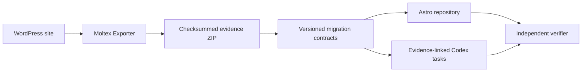

<p>
  <picture>
    <source media="(prefers-color-scheme: dark)" srcset="./docs/assets/moltex-wordmark-dark.svg">
    <source media="(prefers-color-scheme: light)" srcset="./docs/assets/moltex-wordmark-light.svg">
    
  </picture>
</p>

# Moltex

[](./moltex_exporter/)
[](./LICENSE)

**Move a content-led WordPress site into Astro without pretending that copying posts is
the whole migration.**

Moltex exports source evidence, compiles it into versioned migration contracts, generates
an Astro repository, and gives Codex a bounded list of work that still needs judgment. A
separate verifier checks the result. The generated website has no WordPress or Moltex
runtime dependency.

> [!NOTE]
> Moltex is in active development. The exporter source is at 1.3.1, and the harness can run the
> supported fixture through intake, contract compilation, Astro generation, planning, and
> baseline verification. A fresh supported staging pilot is still required before a
> production-readiness claim.

## Run the pipeline

Build the installable exporter ZIP from a clean commit:

```powershell
powershell -NoProfile -ExecutionPolicy Bypass -File moltex_exporter/tools/build-release.ps1
```

Install `dist/moltex-exporter-1.3.1.zip` on a staging copy of the WordPress site, run a
complete export, and review the downloaded ZIP for private data. Then run:

```bash
uv sync --project moltex_harness
uv run --project moltex_harness moltex create-site path/to/moltex-export.zip
```

Moltex writes a new repository under `output/<site-and-export-time>/`. It contains the
Astro source, localized media, source contracts, Codex task graph, verification scripts,
and machine-readable reports.

Generated workspaces pin Node 24.14.0 and npm 10.9.2:

```bash
cd output/<site-and-export-time>
npm ci
npm run build
npm run verify
```

## How it works



Moltex has two internal projects:

- [`moltex_exporter`](./moltex_exporter/) is a read-only WordPress plugin. It records the
  site and packages a privacy-filtered, checksummed `moltex-export/1` archive.
- [`moltex_harness`](./moltex_harness/) validates that archive, compiles canonical
  contracts, acquires approved public assets, generates Astro, plans the remaining work,
  and verifies the output.

The ZIP is the boundary between observation and migration decisions. The exporter never
generates Astro code. The harness never reads the live WordPress database.

## What Moltex preserves

- Published content, custom post types, taxonomies, routes, menus, media relationships,
  SEO data, and redirects
- Plugin, theme, custom-field, shortcode, form, and integration evidence needed to decide
  what must be reproduced or replaced
- Source lineage for generated contracts and explicit findings where the source evidence
  does not support an automatic decision
- A task graph with protected files, dependencies, acceptance commands, and evidence for
  each piece of remaining migration work

## Current support

| Source site | Current result |
| --- | --- |
| Classic or Gutenberg content-led site | Eligible, subject to migration tasks and verification |
| Static ACF fields | Preserved through typed contracts within declared fields |
| Tested GeoDirectory listing data | Preserved; interactive directory behavior still requires explicit replacement work |
| Forms, custom shortcodes, or external integrations | Recorded as blocking decisions until a target is chosen |
| Elementor or Divi | Ineligible for complete migration until a dedicated adapter exists |
| Ecommerce, memberships, LMS, bookings, or multisite | Ineligible for the current static profile |

Moltex fails closed when the evidence exceeds its support boundary. It does not turn
rendered HTML into a false claim of feature parity. See the
[support and readiness report](./docs/support-readiness.md) for the executable rules.

## What verification means

A green baseline proves that Moltex accepted the export, compiled the contracts, localized
approved assets, built the Astro repository, and passed the generated checks. It does not
mean every plugin behavior or visual detail was recreated. Moltex records that work as
explicit tasks instead of hiding it behind a successful content import.

The repository includes reviewed evidence for:

- reproducible exporter release packaging;
- hostile archive and privacy checks;
- route, asset, SEO, redirect, accessibility, and visual verification;
- mutation tests that insert known defects and require the verifier to identify them.

Start with the [previous release-readiness receipt](./docs/verification/x7-release-readiness-receipt.md)
and the [export bundle contract](./docs/export-bundle-contract.md).

## Repository map

```text
moltex_exporter/       WordPress evidence exporter
moltex_harness/        Intake, conversion, generation, planning, and verification
samples/               Sanitized export fixtures
docs/                  Contracts, readiness rules, and verification receipts
moltex.md              Product scope and exporter plan
moltex_harness.md      Harness implementation and verification plan
```

The separate [GeoDirectory replatforming proposal](./GDirectory_replatforming.md) targets
Payload CMS and Astro. It is not part of the current content-led Moltex pipeline.

## Development

Harness development uses Python 3.11 and `uv`:

```bash
uv sync --project moltex_harness
uv run --project moltex_harness pytest
uv run --project moltex_harness ruff check moltex_harness/src moltex_harness/tests
uv run --project moltex_harness mypy --config-file moltex_harness/pyproject.toml moltex_harness/src/moltex_harness
```

Exporter development uses PHP, Composer, PHPUnit, standalone regressions, and disposable
WordPress installations. See the [exporter test guide](./moltex_exporter/tests/README.md).

## License

Moltex is available under the [MIT License](./LICENSE). The WordPress exporter includes its
own component license.
